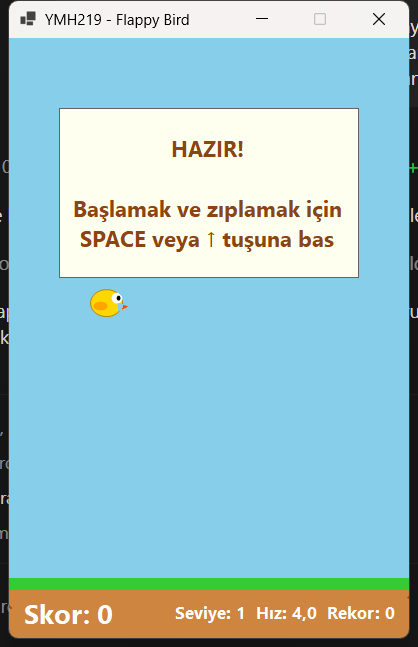
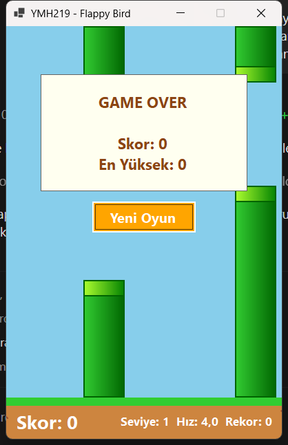

# YMH219-FlappyBird

Nesne Tabanlı Programlama (YMH 219) dersi ek uygulama ödevi: Windows Forms üzerinde **Timer** ve **klavye olayları** kullanılarak geliştirilmiş Flappy Bird benzeri bir masaüstü oyunu.

Kuş SPACE / ↑ tuşuyla zıplar, yer çekimiyle düşer. Sağdan sola gelen borulardaki boşluklardan geçtikçe skor artar; boruya veya zemine çarpınca oyun biter.

## Kullanılan Teknolojiler

- C# / .NET 8 (`net8.0-windows`)
- Windows Forms (PictureBox, Label, Button, `System.Windows.Forms.Timer`)
- System.Drawing (kuş ve boruların kodla çizilmesi)
- Harici NuGet paketi **yok**

## Kurulum ve Çalıştırma

**Visual Studio ile**
1. Depoyu klonlayın: `git clone https://github.com/<kullanici-adi>/YMH219-FlappyBird.git`
2. `YMH219-FlappyBird.sln` dosyasını Visual Studio ile açın.
3. `F5` ile çalıştırın.

**Komut satırı ile**
```
dotnet run --project FlappyBird
```

> .NET 8 kurulu değilse proje `RollForward=LatestMajor` ayarı sayesinde makinedeki daha yeni .NET sürümüyle de çalışır.

## Kontroller

| Tuş / Buton | İşlev |
|---|---|
| SPACE veya ↑ | Oyunu başlat / zıpla |
| Yeni Oyun | Game Over sonrası oyunu yeniden başlat |

## Temel Özellikler

- Kuş klavye ile yukarı hareket eder, yer çekimi ile aşağı iner.
- Ekranda aynı anda 3 engel sağdan sola akar; ekrandan çıkan engel en sağdaki engelin arkasına, yeni bir rastgele boşluk yüksekliğiyle yeniden konumlandırılır.
- Boruya veya zemine çarpınca oyun durur ve **Game Over** ekranı gösterilir.
- Her geçilen engel 1 puan kazandırır.
- **Yeni Oyun** butonu ile oyun yeniden başlatılır.
- Skor, seviye, hız ve oyun durumu `GameState` sınıfının özellikleriyle yönetilir.
- *İsteğe bağlı:* En yüksek skor dosyada saklanır (`%LocalAppData%\YMH219-FlappyBird\highscore.txt`).
- *İsteğe bağlı:* Her 5 puanda seviye atlanır ve engellerin hızı artar.

## Proje Yapısı

```
FlappyBird/
├── Program.cs               Giriş noktası
├── MainForm.cs              Oyun döngüsü, klavye olayları, arayüz güncelleme
├── MainForm.Designer.cs     Form kontrolleri ve Timer tanımları
├── Models/
│   ├── Bird.cs              Kuş: yer çekimi, zıplama, çarpışma kutusu
│   ├── Pipe.cs              Engel: üst/alt boru, hareket, yeniden konumlama, çarpışma
│   └── GameState.cs         Skor, seviye, hız, rekor ve oyun durumu (Ready/Running/GameOver)
└── Services/
    └── HighScoreStore.cs    En yüksek skoru dosyaya yazma/okuma (hata kontrollü)
```

## Ekran Görüntüleri

| Başlangıç | Game Over |
|---|---|
|  |  |

## Bilinen Sınırlamalar / Geliştirme Notları

- Ses efekti ve zorluk seviyesi seçimi eklenmedi.
- Windows Forms kontrolleri ile çizildiği için çok yüksek hızlarda hafif titreme olabilir.
- `System.Windows.Forms.Timer` çözünürlüğü (~15 ms) nedeniyle oyun hızı makineden makineye çok az farklılık gösterebilir.

## Öğrenci

- **Ad Soyad:** Arda Yeşil
- **Öğrenci No:** 250542013
